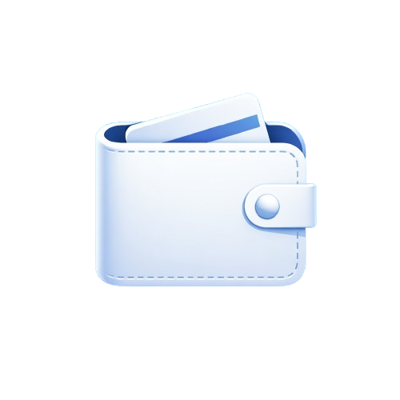

# MyFinance

**Simple personal finance tracker with interactive charts.**

MyFinance is a lightweight web application built with Flask that allows you to track income and expenses, categorize transactions, set up recurring entries and visualize your financial data with charts. Everything is stored locally in a SQLite database. No cloud, no external services, just your data.

<p align="center">
  <br>
  

  <br>


  
  
  
</p>

## Features

* **Income and expense tracking:** Easily add and categorize transactions
* **User accounts:** Every user has a username and a password, and only sees their own data
* **Custom categories:** Separate categories for income and expenses
* **Recurring rules:** Entries that are added automatically every day, week, month or year
* **Interactive charts:**
  * Income distribution (pie chart)
  * Expense distribution (pie chart)
  * Bar, line and pie charts for each category, with filters
* **Filters:** Filter income and expenses by category and by date range
* **Edit and delete entries:** Full control over your data
* **Import and export:** Save all your entries to a JSON file and load them back
* **Custom colors:** Choose the colors used in the charts
* **Local storage:** Data is saved in a SQLite database
* **Minimal UI:** Clean and simple interface

## Quick Start

MyFinance runs inside Docker, so you do not need to install Python or any library on your computer.

### Prerequisites

* Docker
* Python

### Installation

1. Clone the repository

Open a terminal in your home directory and type:
```bash
git clone https://github.com/Lif28/MyFinance.git
cd MyFinance
```

2. Generate a secret key

Flask uses a secret key to protect the login cookie. Without your own key, the app uses a default one ('dev') that is not safe. Generate a random key with:

```bash
python3 -c "import secrets; print(secrets.token_hex(32))"
```

3. Build the image

```bash
docker build -t myfinance .
```

4. Create the container

Replace '...' with the key you generated:
Replace 'your_ip' with the ip myfinance is running on

```bash
docker create --name myfinance \
  -e SECRET_KEY="..." \
  -p your_ip:5000:5000 \
  myfinance
```

5. Start the container

```bash
docker start myfinance
```

6. Open the app

Go to `http://your_ip:5000` in your browser, create an account and log in.


The database is created automatically the first time the app starts.

## Usage

### Register
1. Click the register button
2. enter a username and a password
3. Press the button to register you local account
4. You'll be redirected to a login page

### Login
1. Enter your credentials
2. Press the button to login
<br><br>

<p align="center">
  
  
</p>

### Adding Income

1. Select a category (e.g. Salary, Shares)
2. Choose a date (if you leave it empty, today is used)
3. Enter an amount
4. (Optional) Add notes
5. Click Add

### Adding Expenses

1. Select a category (e.g. Food, Travels)
2. Choose a date (if you leave it empty, today is used)
3. Enter an amount
4. (Optional) Add notes
5. Click Add

<br><br>


### Managing Entries

Open the Table page to see all your entries.

* **Delete:** Select one or more rows and click Delete
* **Edit:** Select one or more rows, click Edit, change the values and click Save


### Recurring Rules

Open the Rules page and click Add. Choose a name, a category, a frequency, the date of the first entry and the amount. From that date on, the app adds a new entry every time the chosen period passes. You can edit or delete rules from the same page.


### Charts

The Overview page shows two charts:

* **Income Pie Chart:** distribution of income sources
* **Expense Pie Chart:** distribution of expenses

The Income and Expenses pages show three charts each (bar, line and pie), and you can filter them by category or by date.


### Settings

Click the logo in the top bar to open the settings. There you can change your password, your categories and your chart colors, export or import your entries, log out or delete your account.

<p align="center">
  
  
</p>

## How It Works

### Data Storage

All data is stored locally in a SQLite database. Inside the container:

```
/app/instance/myfinance.db
```

It contains three tables: users, entries and rules. Every entry and every rule belongs to one user, and each user can only see their own rows. Passwords are saved as hashes.

The database lives inside the container, so it is kept when you stop or restart the container, but it is lost if you remove the container. 

### **Before updating the app, save a copy by going to settings, than click the Export button**

### Import and Export

The export file is a JSON object. Each key is the date of an entry, and each value is a list with the category, the amount, true for income or false for expense, and the notes.

```
{
  "2026-04-01 16:45:00": ["Clothes", 15.0, false, "T-shirt"]
}
```

*When you import a file, any new category it contains is added to your lists automatically.*

### Logs

The app writes events such as logins, imports and errors to `logs/app.log` inside the container. The file is rotated automatically, so it never grows too much. You can also read the output of the app with `docker logs myfinance`.

## Project Structure

```
MyFinance/
├── myfinance/
│   ├── __init__.py          # App setup and logging
│   ├── auth.py              # Register, login, logout
│   ├── dashboard.py         # Overview page and add entry
│   ├── income_expenses.py   # Income and Expenses pages
│   ├── table.py             # Table, edit and delete entries
│   ├── rules.py             # Recurring rules
│   ├── settings.py          # Settings, import, export, delete account
│   ├── db.py                # Database helpers and rules processing
│   ├── errors.py            # Error pages
│   ├── schema.sql           # Database tables
│   ├── static/              # CSS, images and echarts.min.js for pyecharts
│   └── templates/           # HTML pages
├── Dockerfile               # Instructions to build the image
├── requirements.txt         # Python libraries
└── README.md                # Documentation
```

## Dependencies

```
Flask
pyecharts
dateutils
gunicorn
```

Docker installs them for you when you build the image.

## Disclaimer

This software is provided "as is" without warranty of any kind. The developer is not responsible for data loss, or incorrect financial calculations.

## Deployment

MyFinance is designed to run on a home server for continuous access.

A recommended setup is running the container on a **Proxmox server** (or any Linux server), with nginx in front of it, allowing you to access your finance dashboard from any device on your network.


### Start at boot

To start the container when the server boots, create the file `/etc/systemd/system/myfinance.service`:

```
[Unit]
Description=MyFinance
After=docker.service
Requires=docker.service

[Service]
ExecStart=/usr/bin/docker start -a myfinance
ExecStop=/usr/bin/docker stop myfinance
Restart=always
RestartSec=5

[Install]
WantedBy=multi-user.target
```

Then enable it:

```bash
systemctl daemon-reload
systemctl enable --now myfinance
```

### Reverse proxy

You can also use ngnix as a reverse proxy to myfinance

### Updating the app

1. Stop the service: `systemctl stop myfinance`
2. Save a copy of the database with the export button in the settings, as shown above
3. Remove the old container: `docker rm myfinance`
4. Build or load the new image
5. Create the container again with the same secret key
6. Start the service: `systemctl start myfinance`
7. Load the file exported again
